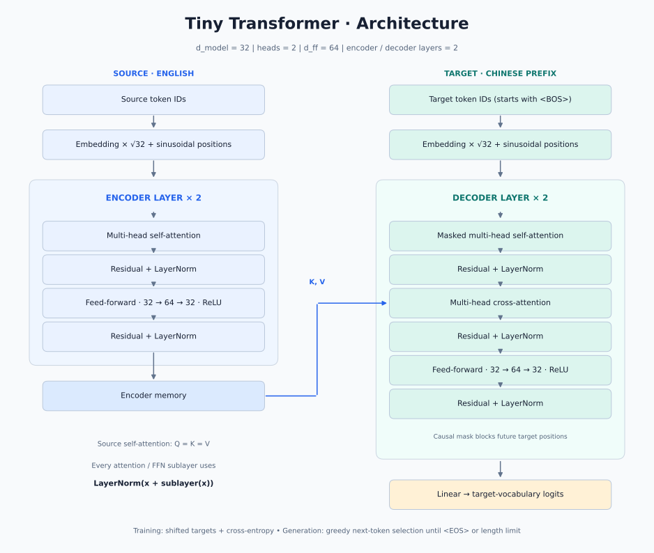
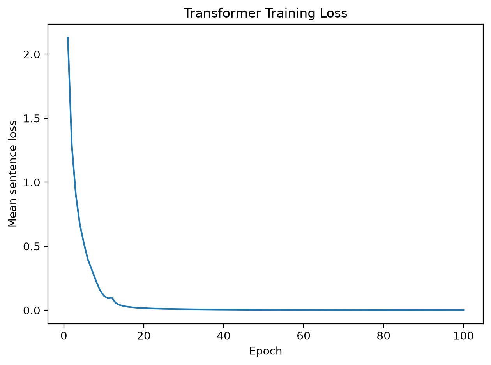

# Tiny Transformer from Scratch

[English](README.md) | **简体中文**

[](https://colab.research.google.com/github/Zguoxu/tiny-transformer-from-scratch/blob/main/tiny_transformer.ipynb)
**用一个 Python 文件，理解 Transformer 如何完成英译中。**

基于 PyTorch，手动实现 Transformer 的核心结构：从词嵌入、位置编码、多头注意力，到 Encoder、Decoder，再到训练和自回归生成。

不调用 `nn.Transformer` 或 `nn.MultiheadAttention`，适合已经了解 PyTorch 基础、想通过代码理解 Transformer 内部计算过程的学习者。

## 项目特点

- **单文件实现**：模型、数据处理、训练和翻译都在 `transformer.py` 中。
- **核心模块手写**：包括缩放点积注意力、多头注意力、因果掩码和交叉注意力。
- **无需下载数据集**：内置 8 组英中句对，模型维度为 32，使用 2 个注意力头、2 层 Encoder 和 2 层 Decoder。
- **完整运行流程**：构建词表 → 训练模型 → 保存损失曲线 → 生成中文翻译。
- **中文注释**：帮助理解关键模块与训练步骤。

## 模型结构



Encoder 和 Decoder 各堆叠两层。在 Decoder 的交叉注意力中，Q 来自解码器，K、V 来自编码器输出。每个注意力和前馈子层都采用残差连接，再做层归一化，与实际代码保持一致。

[下载 PNG 图片](assets/architecture.png)

## 运行效果

输入：

```text
there is a black dog under the chair
```

一次实际运行的输出：

```text
椅子下面有一只黑色狗
```

训练日志：

```text
Epoch   1 | loss=2.1297
Epoch  20 | loss=0.0163
Epoch  40 | loss=0.0050
Epoch  60 | loss=0.0025
Epoch  80 | loss=0.0015
Epoch 100 | loss=0.0010
```

### 训练损失曲线



横轴为训练轮次，纵轴为每轮各句交叉熵损失的平均值。每次运行会将曲线保存至 `assets/loss_curve.png`。

这是一个学习用的小型演示，训练数据仅有 8 组句对，词表固定，输入包含词表以外的单词时会报错。上面的输入是训练词汇的新组合；示例输出和较低的训练损失不代表模型具有通用翻译能力。不同运行环境下的数值和输出可能略有差异。

## 在浏览器中运行

点击顶部的 **Open in Colab**，选择普通 CPU 运行时，再选择 **运行时 → 全部运行**。双语笔记本按步骤介绍模型、训练并显示损失曲线，还可以修改英文输入尝试翻译。无需在本地配置 Python，运行时需要登录 Google 账号。

## 快速开始

已在 Python 3.12 环境下运行验证，依赖 PyTorch 和 Matplotlib。

```bash
git clone https://github.com/Zguoxu/tiny-transformer-from-scratch.git
cd tiny-transformer-from-scratch
python -m venv .venv
```

激活虚拟环境：

```bash
# macOS / Linux
source .venv/bin/activate

# Windows PowerShell
.venv\Scripts\Activate.ps1
```

安装依赖并运行：

```bash
python -m pip install -r requirements.txt
python transformer.py
```

程序会训练 100 轮并保存、显示损失曲线。**关闭图表窗口后**，终端会输出翻译结果。

如果在没有图形界面的服务器上运行，可使用以下命令保存图片并继续输出翻译（macOS / Linux）：

```bash
MPLBACKEND=Agg python transformer.py
```

## 建议阅读顺序

| 步骤 | 对应代码 | 关注点 |
| --- | --- | --- |
| 1. 数据与词表 | `en_cn_pairs`、`source_ids`、`target_ids` | 文本如何转换为 token ID，BOS 和 EOS 的作用 |
| 2. 输入表示 | `TokenEmbedding`、`PositionalEncoding` | 词嵌入与正弦位置编码如何相加 |
| 3. 注意力机制 | `attention`、`AttentionHead`、`MultiHeadAttention` | Q、K、V，缩放点积与多头拼接 |
| 4. 编码器 | `EncoderLayer`、`Encoder` | 自注意力、前馈网络、残差连接与层归一化 |
| 5. 解码器 | `DecoderLayer`、`Decoder` | 因果掩码与对编码器输出的交叉注意力 |
| 6. 完整模型 | `Transformer` | 编码、解码与词表输出投影 |
| 7. 训练与生成 | 训练循环、`translate` | 目标序列错位、交叉熵和逐 token 贪心生成 |

## 动手试试

- 修改 `HEADS`，比较不同注意力头数的训练表现，注意 `D` 必须能被 `HEADS` 整除。
- 修改 `NUM_LAYERS`，观察模型深度变化对训练的影响。
- 在 `en_cn_pairs` 中增加句对，重新运行以构建词表并训练。
- 修改最后一行的英文输入，使用现有词表尝试不同的词语组合。
- 阅读 `attention` 中的因果掩码，理解 Decoder 如何避免看到后续 token。

## 文件结构

```text
tiny-transformer-from-scratch/
├── README.md
├── README.zh-CN.md
├── LICENSE
├── tiny_transformer.ipynb
├── transformer.py
├── requirements.txt
├── .gitignore
└── assets/
    ├── architecture.svg
    ├── architecture.png
    └── loss_curve.png
```

如果这个项目帮助你理解了 Transformer，欢迎点一个 ⭐ Star，方便以后回来复习。也欢迎通过 Issue 交流学习中的问题。

## 许可证

本项目采用 [MIT 许可证](LICENSE)。在保留版权和许可声明的前提下，允许使用、修改和分发，包括商业用途。软件不提供担保。
